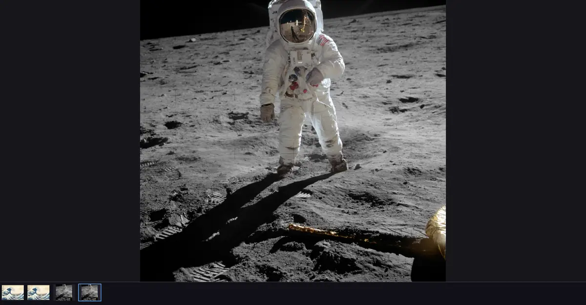
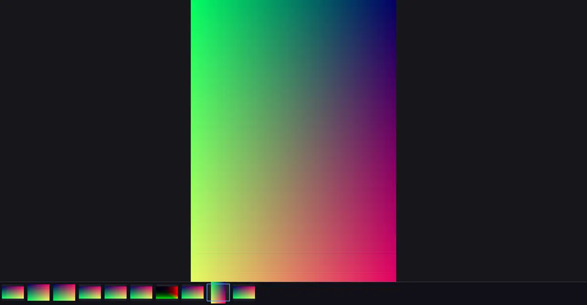
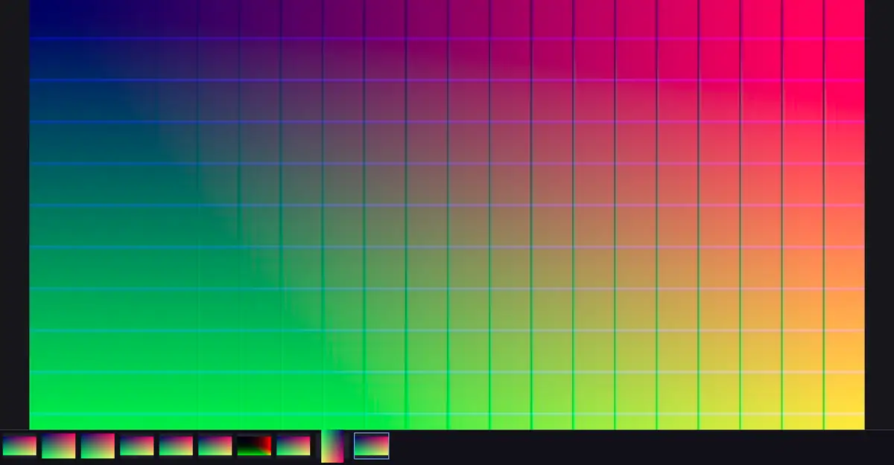
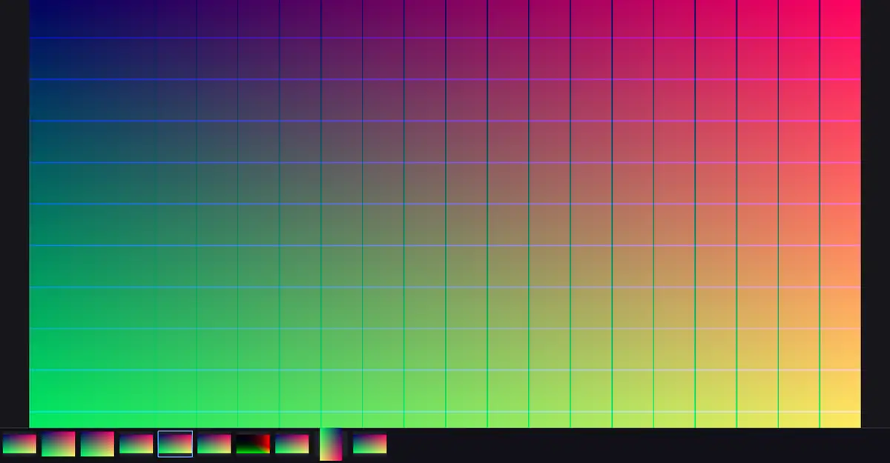

# Voxprint AI Lucent

  

Lucent opens a picture quickly and keeps the colour you expect.

   
  A photograph

   
  A portrait stored on its side, shown upright

   
  A wide-gamut still

   
  A JPEG XL still

- [Roadmap](roadmap.md)
- [Architecture](ARCHITECTURE.md)
- [Command line](CLI.md), generated from the programs' own `--help`
- [Python API](python.md)
- [C++ API](cpp/index.html)
